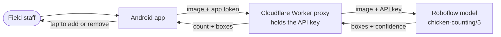

<div align="center">

# 🐔 Chicken Counter

**Human-verified poultry counting on an Android phone.**<br>
Computer vision draws a box on every bird. A person fixes what it got wrong. Only then does the count enter the total.

[Documentation site](https://nwokahovercomer.github.io/chicken-counter/) ·
[Architecture](docs/architecture/system-overview.md) ·
[Design decisions](docs/decisions/index.md) ·
[Changelog](docs/project/changelog.md)


</div>

## At a glance

| | |
|---|---|
| **Problem** | Counting a large flock by hand is slow and hard to double-check. Automatic counts are fast, but silently wrong when birds overlap or are hidden. |
| **Approach** | The phone camera feeds a cloud object-detection model. The app freezes the frame, draws every detection, and lets the operator add missed birds or remove wrong boxes **before** the count is committed to a running total. |
| **Stack** | React Native (Expo) and TypeScript · Cloudflare Workers proxy · Roboflow hosted inference · EAS Build for private APK distribution |
| **My role** | Solo project: requirements, architecture, implementation, testing, deployment and documentation. |



## Status

<!-- UPDATE after the v2 field test: change the first row to "Released" and bump the date. -->

| Component | Version | Status | Details |
|---|---|---|---|
| Android app v2 (detect and correct) | 1.1.0 | Feature complete. APK build and field validation in progress. | [Testing](docs/engineering/testing.md) |
| Android app v1 (sets of three photos) | 1.0.0 | Built and sideloaded privately. Superseded by v2. | [History](docs/project/history.md) |
| Proxy (Cloudflare Worker) | n/a | Deployed. v2 adds box coordinates and stays backward compatible. | [API reference](docs/architecture/api-reference.md) |
| Desktop prototype (Python) | 0.1.0 | Archived. | [`desktop/`](desktop/README.md) |
| Documentation | n/a | Current as of 2026-10-29. Checked by CI on every change. | [Documentation system](docs/meta/documentation-system.md) |

No accuracy figures are published yet: the app records how often the model needed correcting, and
the first field data has not been collected. See [Problem and goals](docs/overview/problem-and-goals.md#how-success-is-measured).

## What it does (v2)

1. **Live camera** with one large **Detect** button (or pick a photo from the gallery).
2. The frame **freezes** and a box is drawn on every detected bird, with the count shown.
3. **Correct it**: tap a box to remove it, tap empty space to add a bird, zoom 2× or 3× in dense groups. Boxes the model is unsure about are highlighted.
4. **Add to total.** The verified count joins the running total, and the camera returns for the next group.
5. The total and every count (with how much was corrected) are saved on the phone and survive restarts.

How it is used in practice: [User guide](docs/overview/user-guide.md).

## Why this is relevant to automation and engineering work

| Competency | Where to see it |
|---|---|
| Edge-to-cloud systems integration (device, API gateway, ML inference) | [System overview](docs/architecture/system-overview.md) · [Data flow](docs/architecture/data-flow.md) |
| Human-in-the-loop design and operator interface (HMI) | [ADR 0005](docs/decisions/0005-human-in-the-loop-correction.md) · [User guide](docs/overview/user-guide.md) |
| Fault tolerance: timeouts, retries, clear failure messages | [API reference](docs/architecture/api-reference.md) · [Risks](docs/project/risks-fmea.md) |
| Cybersecurity and secrets management | [Security and privacy](docs/architecture/security-and-privacy.md) · [ADR 0002](docs/decisions/0002-cloudflare-worker-proxy.md) |
| Requirements and traceability, verification and validation | [Requirements](docs/overview/requirements.md) · [Testing](docs/engineering/testing.md) |
| Risk analysis (FMEA-style failure modes and mitigations) | [Risks](docs/project/risks-fmea.md) |
| Configuration and change control | [Decision log](docs/decisions/index.md) · [Changelog](docs/project/changelog.md) |
| Deployment and operations | [Distribution](docs/engineering/distribution.md) · [Runbook](docs/engineering/operations-runbook.md) |
| Iterating on real feedback | [Project history](docs/project/history.md) · [Lessons learned](docs/project/lessons-learned.md) |
| Documentation engineering and CI | [Waterfall or Agile?](docs/meta/documentation-approach.md) · [Documentation system](docs/meta/documentation-system.md) |

## Where to start reading

- **2 minutes:** this page, then the [User guide](docs/overview/user-guide.md).
- **10 minutes:** [System overview](docs/architecture/system-overview.md), the [Decision log](docs/decisions/index.md), and [Risks](docs/project/risks-fmea.md).
- **Deep dive:** [API reference](docs/architecture/api-reference.md), [Security](docs/architecture/security-and-privacy.md), [Testing](docs/engineering/testing.md), [Runbook](docs/engineering/operations-runbook.md).

## Repository layout

```text
chicken-counter/
├── app/        Android app (Expo, React Native, TypeScript)
├── proxy/      Cloudflare Worker proxy and its automated tests
├── desktop/    Archived Python prototype
├── docs/       All documentation (this site), Markdown + Mermaid
├── tools/      Documentation checks used by CI
└── .github/    CI workflows, PR and issue templates, Dependabot
```

## Developer quick start

```bash
node --test proxy/test/worker.test.mjs     # proxy tests, no secrets needed
pip install -r requirements-docs.txt
python tools/check_docs.py                 # links, nav, freshness
zensical serve                             # preview the docs at http://localhost:8000
```

Building and running the app: [Setup and build](docs/engineering/dev-setup-and-build.md).

## Security note

No credentials are in this repository. The model API key lives only as a Cloudflare secret, the app
reads its proxy address and token from a git-ignored `app/src/config.ts` (template:
[`config.example.ts`](app/src/config.example.ts)), and CI scans the full history for secrets.
The installable APK is **not** published here: it contains the app token, so it is distributed
privately. Details: [Distribution](docs/engineering/distribution.md).

## License and contact

MIT, see [LICENSE](LICENSE). The detection model is a public third-party model, subject to its own
license on Roboflow Universe.

Overcomer C. Nwokah · [LinkedIn](https://www.linkedin.com/in/overcomernwokah) · [GitHub](https://github.com/nwokahovercomer)
