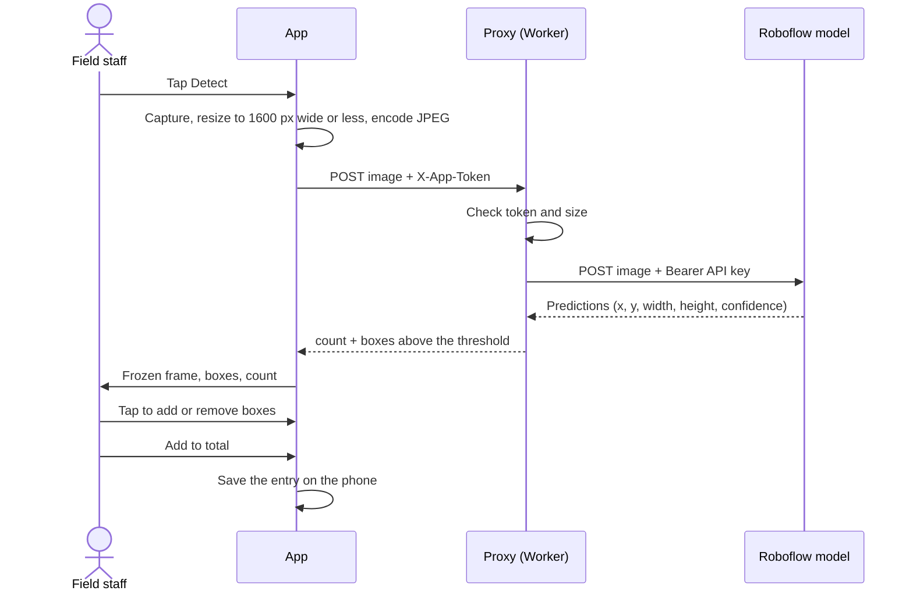
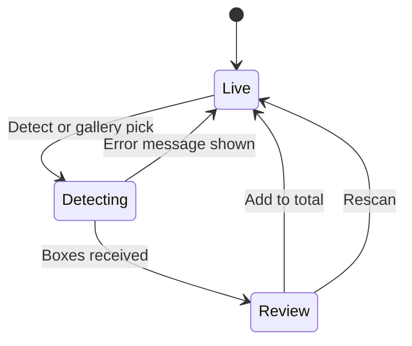

# Data flow

*Last reviewed: 2026-10-29 · Applies to: app 1.1.0 (v2)*

## Detect and correct



## App states



The camera is locked as soon as *Detecting* begins, so a double-tap cannot capture twice (TC-19 in [Testing](../engineering/testing.md)).

## Coordinates

The model reports each box by its **centre** (`x`, `y`) and size in **pixels of the image it received**.
The app converts every box to **fractions of the image** (0 to 1) using the image size the proxy reports
(falling back to the size the app sent):

```text
cx = x / imageWidth        w = width  / imageWidth
cy = y / imageHeight       h = height / imageHeight
```

Fractions keep boxes glued to the right birds at any zoom level or screen size. The review screen
shows the *re-encoded image that was uploaded*, not the original photo, so the picture and the box
positions always come from the same pixels.

## Data model

Both types live in `app/src/types.ts`.

**Box** (exists only while reviewing one frame)

| Field | Meaning |
|---|---|
| `cx`, `cy`, `w`, `h` | Centre and size as fractions of the image |
| `confidence` | 0 to 1 for model boxes, `null` for boxes added by hand |
| `source` | `model` or `manual` |
| `removed` | `true` for a model box the user rejected (kept on screen in red so it can be restored) |

**Entry** (one saved count, persisted on the phone)

| Field | Meaning |
|---|---|
| `count` | Final verified count = `modelCount − removed + added` |
| `modelCount` | What the model found |
| `added`, `removed` | Corrections the operator made |
| `createdAt` | Timestamp |

The **running total is derived** (the sum of `count` over all entries), never stored separately, so
deleting an entry cannot leave the total wrong. Only entries are saved; photos are not
([ADR 0007](../decisions/0007-persist-counts-only.md)).

## Corrections

| Action | Result |
|---|---|
| Tap a model box | `removed` flips on or off (count −1 or +1) |
| Tap a hand-added box | The box is deleted |
| Tap empty space | A new manual box is added, sized like the median of the other boxes in the frame (5% of the width if there are none) |

## Error handling

| Failure | Behaviour |
|---|---|
| No signal or timeout (30 s) | One retry, then a "Network error" or "Request timed out" message; the app returns to the camera |
| Server error (5xx) | One retry, then the message |
| 401, 413, or an outdated proxy | No retry (it would fail the same way); a specific message is shown |
| Camera returned no photo | Message; the app returns to the camera |

Failure modes and mitigations in full: [Risks](../project/risks-fmea.md).

## Related

[System overview](system-overview.md) · [API reference](api-reference.md) · [ADR 0005](../decisions/0005-human-in-the-loop-correction.md)
