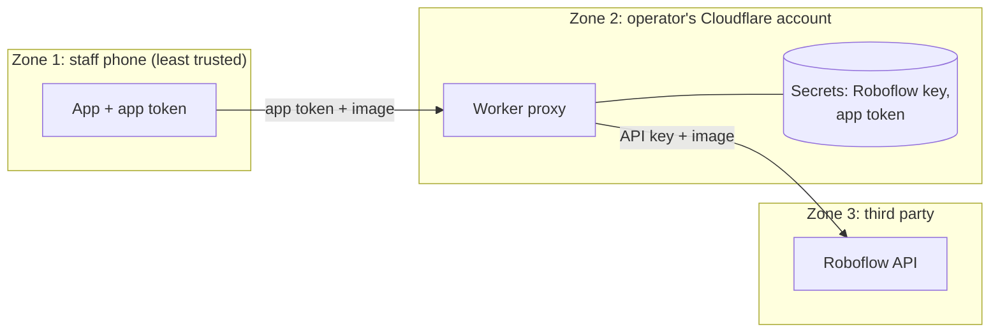

# Security and privacy

*Last reviewed: 2026-10-29 · Applies to: app 1.1.0 (v2)*

## Trust boundaries

The phone is treated as untrusted because an APK can be unpacked. Anything inside it is readable by
whoever holds the file. That is why the valuable credential (the model API key) lives only in zone 2
([ADR 0002](../decisions/0002-cloudflare-worker-proxy.md)).

## Threats considered

| Threat | Example | Mitigation | Residual risk |
|---|---|---|---|
| **Spoofing** | Someone calls the proxy pretending to be the app | `X-App-Token` check (constant-time compare) | Token can be extracted from the APK, so this only stops casual use |
| **Tampering** | Altering a request in transit | HTTPS between all zones | Low |
| **Information disclosure: key** | Model API key read out of the app | Key never in the app or repository; sent only as a `Bearer` header, never in a URL | Low |
| **Information disclosure: photos** | Images intercepted or retained | HTTPS; proxy stores nothing; app stores no photos | Roboflow's own retention is outside this project's control. Review their terms. |
| **Denial of service / cost abuse** | Flooding the proxy to burn quota | Upload size cap (8 MB), token check | No rate limiting yet ([Roadmap](../project/roadmap.md)) |
| **Repudiation** | "Who submitted this count?" | Not addressed: no user accounts | Accepted for a small private deployment |
| **Lost or stolen phone** | Token exposed with the device | Rotate the token and rebuild ([Runbook](../engineering/operations-runbook.md#lost-or-stolen-phone)) | Old APKs stop working immediately |

## Secrets inventory

| Secret | Lives in | Exposure | Rotation |
|---|---|---|---|
| Roboflow API key | Cloudflare secret `ROBOFLOW_API_KEY` | Operator only | [Runbook](../engineering/operations-runbook.md#rotate-the-roboflow-key): change the secret, no app rebuild |
| App token | Cloudflare secret `APP_TOKEN` and compiled into the APK (`app/src/config.ts`, git-ignored) | Extractable from the APK | [Runbook](../engineering/operations-runbook.md#rotate-the-app-token): change the secret, rebuild, reinstall |
| Cloudflare deploy token | Environment variable on the developer machine | Operator only | Least privilege (Workers Scripts: Write); revoke and recreate |
| Android signing keystore | Managed by EAS; a backup is kept offline | Operator only | See [Distribution](../engineering/distribution.md#signing-keystore) |

## Repository hygiene

- `.gitignore` excludes `config.ts`, keystores, `.env*`, APK/AAB files and build output. A template, `config.example.ts`, is committed instead.
- CI scans the **entire git history** for secrets on every push ([workflow](https://github.com/nwokahovercomer/chicken-counter/blob/main/.github/workflows/secrets-scan.yml)). A key that was committed once and deleted is still leaked.
- The APK is never attached to a public release, because it contains the app token.
- Screenshots and logs are reviewed before publishing: proxy URLs and tokens can appear in them.
- Any credential that appeared in a log, chat, issue or screenshot is **treated as compromised and rotated** ([Lessons learned](../project/lessons-learned.md)).

## Data inventory and privacy

| Data | Where it goes | Kept? |
|---|---|---|
| Photo (resized JPEG) | Phone, then proxy, then Roboflow, over HTTPS | Not saved by the app or the proxy. Temporary files in the app cache are managed by the operating system. |
| Counts (`count`, `modelCount`, `added`, `removed`, time) | Phone storage only | Yes, until deleted ([ADR 0007](../decisions/0007-persist-counts-only.md)) |
| Proxy logs | Cloudflare | Only upstream error status and a short message. Never images. |

Keep people out of frame when counting: photos leave the device to a third-party service.

## Related

[System overview](system-overview.md) · [API reference](api-reference.md) · [Risks](../project/risks-fmea.md) · [Requirements NFR-01, 02, 07](../overview/requirements.md#non-functional-requirements)
