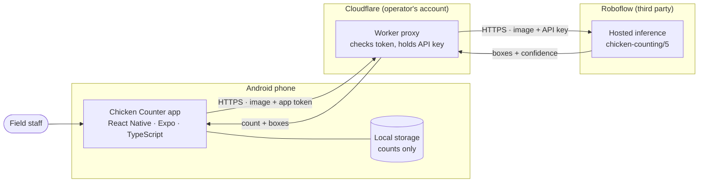

# System overview

*Last reviewed: 2026-10-29 · Applies to: app 1.1.0 (v2)*

Three runtime parts and one build service. The phone never talks to the model directly: a small proxy
sits in between so the model's API key never ships inside the app ([ADR 0002](../decisions/0002-cloudflare-worker-proxy.md)).

## Components

| Component | Responsibility | Technology | Runs on |
|---|---|---|---|
| **Android app** | Camera and gallery capture, resize and encode, call the proxy, draw boxes, handle corrections, keep the running total | React Native (Expo SDK 57), TypeScript | Staff phones |
| **Proxy** | Check the app token, cap upload size, forward the image to the model with the API key, keep detections above the confidence threshold, return count and box coordinates | Cloudflare Workers (JavaScript, stateless) | Cloudflare edge |
| **Model** | Object detection (chicken boxes with confidence) | Roboflow hosted inference, public model `chicken-counting/5` | Roboflow cloud |
| **Build service** | Produces the installable APK in the cloud | Expo Application Services (EAS Build) | Expo cloud |
| **Docs and CI** | Build and verify these docs, run tests, scan for secrets, publish the site | GitHub Actions, GitHub Pages, Zensical | GitHub |

## Technology choices at a glance

| Layer | Choice | Why (short) | Record |
|---|---|---|---|
| App framework | Expo / React Native | Fast iteration, cloud builds, no local Android toolchain | [ADR 0001](../decisions/0001-expo-react-native.md) |
| Secret handling | Proxy holds the key | An APK can be unpacked, so a key inside it is not secret | [ADR 0002](../decisions/0002-cloudflare-worker-proxy.md) |
| Model API access | Direct REST, header auth | The SDK is a thin wrapper and did not install on the prototype's Python version | [ADR 0003](../decisions/0003-direct-rest-header-auth.md) |
| Accuracy strategy | Person verifies before commit | Fixes errors before they are recorded | [ADR 0005](../decisions/0005-human-in-the-loop-correction.md) |
| Distribution | Private APK via EAS | No public store needed | [ADR 0006](../decisions/0006-private-apk-distribution.md) |
| Persistence | Counts only, never photos | Smaller privacy surface | [ADR 0007](../decisions/0007-persist-counts-only.md) |

App libraries: `expo-camera`, `expo-image-picker`, `expo-image-manipulator`,
`@react-native-async-storage/async-storage`, `expo-linear-gradient`, `react-native-safe-area-context`,
`@expo/vector-icons`, `expo-font`.

## Design principles

- **Secrets stay server-side.** The phone holds only a low-value token.
- **Thin client, thin proxy.** The proxy is stateless (no database, no stored images). Intelligence lives in the model and in the operator's review.
- **Additive API changes.** v2 added fields to the proxy response without breaking v1 phones ([API reference](api-reference.md#compatibility)).
- **Configuration over rebuilds.** Model ID and confidence threshold are proxy settings ([Runbook](../engineering/operations-runbook.md)).

## How the architecture meets the non-functional requirements

| Requirement | Mechanism |
|---|---|
| NFR-01 key never in the app | Key exists only as a Cloudflare secret |
| NFR-02 only the app can call | `X-App-Token` check (limited; see [Security](security-and-privacy.md)) |
| NFR-04 change model without rebuild | `MODEL_ID` and `CONFIDENCE` are proxy variables |
| NFR-05 resilience | 30 s timeout, one retry on network or 5xx errors, clear messages ([Data flow](data-flow.md#error-handling)) |
| NFR-06 efficiency | Resize to ≤1600 px, one call per count |

Full list: [Requirements](../overview/requirements.md).

## Source map

| Area | Files |
|---|---|
| App screen and logic | [`app/App.tsx`](https://github.com/nwokahovercomer/chicken-counter/blob/main/app/App.tsx) |
| Box overlay, tap handling, zoom | [`app/src/ReviewCanvas.tsx`](https://github.com/nwokahovercomer/chicken-counter/blob/main/app/src/ReviewCanvas.tsx) |
| Proxy client, image preparation, storage | [`app/src/api.ts`](https://github.com/nwokahovercomer/chicken-counter/blob/main/app/src/api.ts), [`imagePrep.ts`](https://github.com/nwokahovercomer/chicken-counter/blob/main/app/src/imagePrep.ts), [`storage.ts`](https://github.com/nwokahovercomer/chicken-counter/blob/main/app/src/storage.ts) |
| Proxy and its tests | [`proxy/src/index.js`](https://github.com/nwokahovercomer/chicken-counter/blob/main/proxy/src/index.js), [`proxy/test/worker.test.mjs`](https://github.com/nwokahovercomer/chicken-counter/blob/main/proxy/test/worker.test.mjs) |

## Related

[Data flow](data-flow.md) · [API reference](api-reference.md) · [Security and privacy](security-and-privacy.md) · [Decision log](../decisions/index.md)
