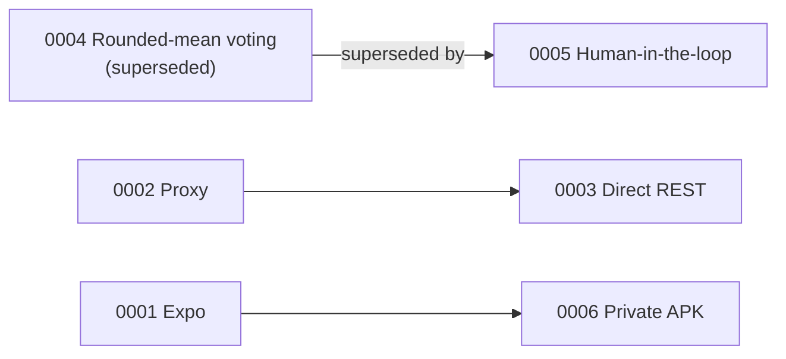

# Decision log

*Last reviewed: 2026-10-29 · Applies to: all versions*

Architecture decision records (ADRs): one short page per significant choice, written when the choice
is made. They are **immutable history**: when a decision changes, a new record supersedes the old one
instead of the old one being edited. That keeps the reasoning behind every pivot visible.
Format adapted from [MADR](https://adr.github.io/madr/).

| ID | Decision | Status | Date |
|---|---|---|---|
| [0001](0001-expo-react-native.md) | Build the Android app with Expo (React Native) | Accepted | 2026-09 |
| [0002](0002-cloudflare-worker-proxy.md) | Route model calls through a Cloudflare Worker so the key stays off the phone | Accepted | 2026-09 |
| [0003](0003-direct-rest-header-auth.md) | Call the model's REST API directly with header authentication | Accepted | 2026-09 |
| [0004](0004-rounded-mean-voting.md) | Combine three photos per set with a rounded mean | **Superseded by 0005** (in the app) | 2026-09 |
| [0005](0005-human-in-the-loop-correction.md) | Let the operator verify and correct detections before they count | Accepted | 2026-10 |
| [0006](0006-private-apk-distribution.md) | Distribute privately as an APK built with EAS | Accepted | 2026-09 |
| [0007](0007-persist-counts-only.md) | Persist counts on the phone, never photos | Accepted | 2026-10 |
| [0008](0008-agile-docs-as-code.md) | Document with Agile, docs-as-code practices | Accepted | 2026-10 |

Dates are month-level because early records were reconstructed from the project history.

## How to add a decision

1. Copy [the template](template.md) to `NNNN-short-title.md` with the next number.
2. Fill it in, set the status, and add a row above and to the nav in `zensical.toml`.
3. If it replaces an older record, mark that record's status *Superseded by NNNN* (the only edit an old record gets).

When to write one: the choice is hard to reverse, affects several parts of the system, or someone
will later ask "why did we do it this way?".

## Related

[System overview](../architecture/system-overview.md) · [Project history](../project/history.md) · [Documentation system](../meta/documentation-system.md)
