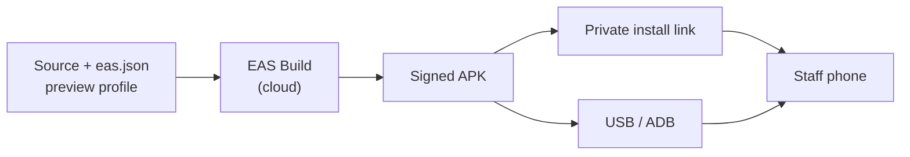

# Distribution

*Last reviewed: 2026-10-29 · Applies to: app 1.1.0*

The app is **not** published to a public store. It is built in the cloud as an APK and installed on a
small set of known phones ([ADR 0006](../decisions/0006-private-apk-distribution.md)).

## Build and install

| Method | Best for | Note |
|---|---|---|
| **USB / ADB** | A few phones you can reach | Nothing is hosted anywhere |
| **EAS install link** | Phones that are far away | Anyone with the link can install it, so treat it like a password |
| **Firebase App Distribution** | Many remote testers | Invite-only by email; extra setup |

## Versions

| Field | Where | Rule |
|---|---|---|
| App version | `version` in `app.json` | Bump for every release; matches the [changelog](../project/changelog.md) |
| Android version code | Set by EAS (`autoIncrement: true`) | Must increase, or Android refuses to install over an older build |

## Signing keystore

EAS generates and stores the signing key. Update installs only work if later builds use the **same**
key; a different key forces an uninstall first (and loses the phone's saved counts).

- Back it up now: `eas credentials`, then download the Android keystore.
- Store the backup **outside** the repository (it is git-ignored) and outside the project folder.

## Do not publish the APK

It contains the app token. A public copy would let anyone extract the token and spend your model
quota ([Security](../architecture/security-and-privacy.md)). Publish screenshots and a short video
on the portfolio instead.

## Platform policy: Android developer verification

Google is rolling out developer verification for apps installed outside the Play Store. As of
2026-10-29, enforcement started on 30 September 2026 in Brazil, Indonesia, Singapore and Thailand,
and a global rollout is planned for 2027. Registering a **limited-distribution** account (a free
option for small private deployments, for up to 20 devices) is the mitigation to put in place before
it applies to your region. Re-check the current rules at the
[official Android Developer Console help page](https://support.google.com/android-developer-console/answer/16561738).

This is tracked as a risk (R-08 in the [risk register](../project/risks-fmea.md)).

## Related

[Setup and build](dev-setup-and-build.md) · [Runbook](operations-runbook.md) · [ADR 0006](../decisions/0006-private-apk-distribution.md)
