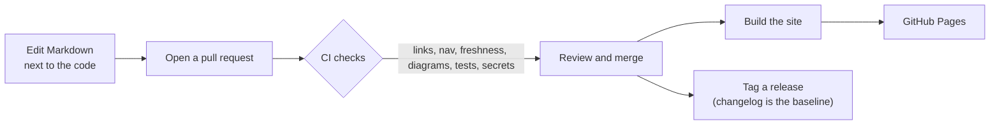

# Documentation system

*Last reviewed: 2026-10-29 · Applies to: documentation tooling · Record: [ADR 0008](../decisions/0008-agile-docs-as-code.md)*

How these docs are written, checked and kept current with as little effort as possible. The approach
and the reasons are in [Waterfall or Agile?](documentation-approach.md).

## Principles

1. **One source of truth, in the repository.** Plain Markdown and Mermaid diagrams, versioned with the code.
2. **Change docs in the same pull request as the code.** A change is not done until its docs are.
3. **Let machines do the boring checks.** Links, navigation, freshness, diagram syntax and secrets are checked in CI.
4. **One purpose per page.** Pages are grouped by what the reader needs ([Diátaxis](https://diataxis.fr/): explanation, how-to, reference, tutorial).
5. **Keep content portable.** Nothing depends on the generator, so the generator can be replaced.

## Layout

| Folder | Purpose | Type |
|---|---|---|
| `docs/overview/` | Problem, requirements, user guide | Explanation, how-to |
| `docs/architecture/` | Structure, data flow, API, security | Explanation, reference |
| `docs/engineering/` | Setup, testing, distribution, runbook | How-to, reference |
| `docs/decisions/` | Immutable decision records | Explanation |
| `docs/project/` | History, roadmap, risks, lessons, changelog | Explanation, plan |
| `docs/meta/` | This page and the approach decision | Explanation |
| `tools/` | Checks run by CI | Tooling |

## Toolchain

| Concern | Choice | Notes |
|---|---|---|
| Content | Markdown + [Mermaid](https://mermaid.js.org/) | Renders on GitHub as it is |
| Site generator | [Zensical](https://zensical.org/), version pinned in `requirements-docs.txt` | See below |
| Hosting | GitHub Pages, deployed by GitHub Actions | Free; the workflow is `.github/workflows/docs.yml` |
| Link, nav and freshness checks | `tools/check_docs.py` | Standard library only |
| Diagram validation | `tools/validate-mermaid.mjs` | Uses the real Mermaid parser |
| Tests | `node --test proxy/test/worker.test.mjs` | Also run in CI |
| Secret scanning | gitleaks over the full history | `.github/workflows/secrets-scan.yml` |
| Dependency updates | Dependabot, monthly | Actions, pip and the tools; not the Expo app |
| Workflow aids | PR template, "user story" issue form, [ADR template](../decisions/template.md) | Make the Definition of Done visible |

**Why Zensical.** The previous standard generator for this style of site, Material for MkDocs, is
[scheduled to reach end of life on 5 November 2026](https://squidfunk.github.io/mkdocs-material/blog/2025/11/05/zensical/),
and Zensical is its successor from the same team. It is still before version 1.0, so the exact version
is pinned and monthly update PRs are reviewed. **Exit plan:** because content is plain Markdown with
Mermaid, switching generators means changing the build step in CI only.

## The workflow



## Update triggers

| When this happens | Update these |
|---|---|
| A feature is added or changed | [Requirements](../overview/requirements.md) (and its traceability row), [User guide](../overview/user-guide.md), a test case in [Testing](../engineering/testing.md), the [changelog](../project/changelog.md) |
| An architecture or technology choice is made | A new [decision record](../decisions/index.md); [System overview](../architecture/system-overview.md) or [Data flow](../architecture/data-flow.md) |
| The proxy API changes | [API reference](../architecture/api-reference.md), `openapi.yaml`, proxy tests |
| A bug or incident happens | [Troubleshooting log](../engineering/dev-setup-and-build.md#troubleshooting-log) or [Runbook](../engineering/operations-runbook.md); [Lessons learned](../project/lessons-learned.md); the [risk register](../project/risks-fmea.md) if an assessment changes |
| A release ships | Move *Unreleased* in the changelog; update the status tables in the README and [home page](../index.md); tag the commit |
| A dependency or tool is upgraded | [Setup and build](../engineering/dev-setup-and-build.md) (versions and new issues) |
| A credential is rotated | Nothing with the value. Update the [Runbook](../engineering/operations-runbook.md) only if the *procedure* changed. |

## Definition of done (documentation part)

- [ ] Pages affected by the change are updated, and `Last reviewed` is bumped on each
- [ ] A changelog line is under *Unreleased*
- [ ] Architecture-level change has a decision record
- [ ] `python tools/check_docs.py` and the diagram validator pass locally or in CI
- [ ] No secrets, tokens or private URLs in text, screenshots or logs

## Cadence

| When | What | Time |
|---|---|---|
| Every pull request | The triggers table and the Definition of done | Minutes |
| Monthly | Run `python tools/check_docs.py`; fix pages it flags as older than 90 days; skim the [roadmap](../project/roadmap.md) and [risks](../project/risks-fmea.md); review Dependabot PRs | About 15 minutes |
| Every release | Changelog baseline, status tables, tag | Part of the release checklist in the [Runbook](../engineering/operations-runbook.md#release-a-new-app-version) |
| Quarterly | Check decision statuses, and watch the toolchain for end-of-life notices | About 30 minutes |

## Writing standards

- Write for the reader's task first; define jargon the first time it appears.
- Prefer tables for comparisons and Mermaid for diagrams; link instead of repeating.
- Dates are ISO (`2026-10-29`). Each living page shows `Last reviewed`.
- Placeholders are written in capitals with hyphens (`nwokahovercomer`) so the checker can find them.
- Never include secrets, tokens or the real proxy address.

## Using an AI assistant safely

Drafting help is fine; accuracy stays with the author. Check every claim against the code and tests, and never paste credentials.
A reusable prompt:

```text
Here is the diff for this change and the "Update triggers" table.
List which documentation pages are affected, propose the edits, and list any existing
statements that may now be false. Do not invent measurements or results.
```

## Run it locally

```bash
pip install -r requirements-docs.txt
python tools/check_docs.py
npm ci --prefix tools && node tools/validate-mermaid.mjs docs README.md
zensical serve
```

## Related

[Waterfall or Agile?](documentation-approach.md) · [ADR 0008](../decisions/0008-agile-docs-as-code.md) · [Testing](../engineering/testing.md)
