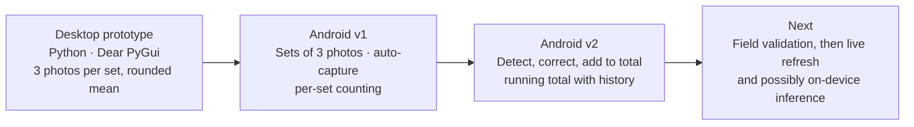

# Project history

*Last reviewed: 2026-10-29 · Applies to: all versions*

The product went through three generations in about a month. Each change was driven by feedback from
using the previous version, which is why the documentation is kept [living rather than frozen](../meta/documentation-approach.md).
Dates are approximate.

## Generations

| Generation | When | What it was | Why it changed |
|---|---|---|---|
| **Desktop prototype** (0.1.0) | Late Sep 2026 | Windows app that counted folders of three photos and averaged them | The work needed to happen in the field, on a phone |
| **Android v1** (1.0.0) | Late Sep to early Oct 2026 | Sets of three photos, manual or auto-capture, counted as each set was approved | Errors were found only after a count was committed, forcing retakes |
| **Android v2** (1.1.0) | Oct 2026 | Live camera, detect, correct the boxes, add to total | Current. In field validation. |

## Iteration log

What changed along the way, and the reason.

**Desktop prototype**
- Started with PySide6, then compared alternatives (CustomTkinter, Dear PyGui, Flet) and chose Dear PyGui, because the machine ran a very new Python version and compiled-package compatibility was a concern.
- Replaced the vendor SDK with direct REST calls and header authentication ([ADR 0003](../decisions/0003-direct-rest-header-auth.md)).
- Voting: rounded mean of the three counts ([ADR 0004](../decisions/0004-rounded-mean-voting.md)); CSV export; light theme.

**Android v1**
- Chose Expo and a Cloudflare proxy to keep the key off the phone ([ADR 0001](../decisions/0001-expo-react-native.md), [ADR 0002](../decisions/0002-cloudflare-worker-proxy.md)).
- **Auto-capture**: three photos taken automatically after a short framing countdown. The first version took about 5 seconds to capture; feedback asked for faster, so it was tightened to about 3.5 seconds.
- **UI**: first built in a purple palette, then rebuilt to match a green design mockup; placeholder boxes and duplicate capture tiles were removed because they added clutter without adding function.
- **Workflow**: moved from "capture everything, then press Count" to **approve a set, and it counts immediately**, with a live total and a cap of three concurrent requests, so hundreds of sets would not wait on one long batch.
- Added a review step (approve or replace a set), edit and delete per set, and a confirmed **Clear all**.
- Branding: custom icon (including the three Android adaptive-icon layers), splash screen, app name.
- Built as a private APK ([ADR 0006](../decisions/0006-private-apk-distribution.md)) and installed on a phone.

**Android v2**
- Observed that v1 still let a wrong count be committed. Explored three ways to show the model's boxes live and chose the one that survives moving birds and a moving camera: freeze one frame, then correct it ([ADR 0005](../decisions/0005-human-in-the-loop-correction.md)).
- Added persistence of counts ([ADR 0007](../decisions/0007-persist-counts-only.md)); the proxy now returns box coordinates and stays compatible with v1.
- While reviewing the v1 code, found that photos were never being resized before upload (the width needed to trigger resizing was never passed in). v2 fixes it and the changelog records it.

## Where the problems were

Most delays were tooling, not product logic: SDK and Expo Go mismatches, build defaults, and token and
permission issues with the hosting CLI. They are recorded with fixes in the
[troubleshooting log](../engineering/dev-setup-and-build.md#troubleshooting-log) and summarised in
[Lessons learned](lessons-learned.md).

## Related

[Roadmap](roadmap.md) · [Changelog](changelog.md) · [Decision log](../decisions/index.md)
